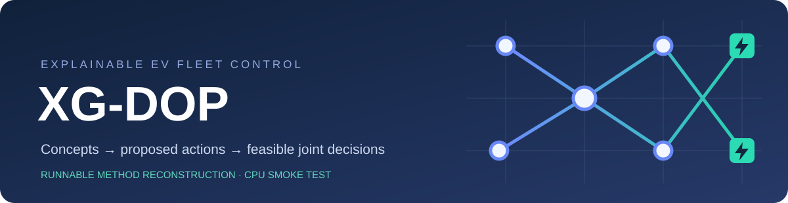
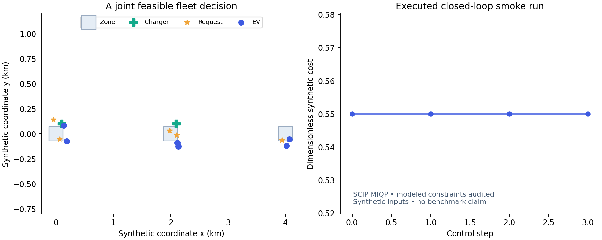
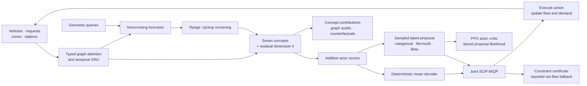
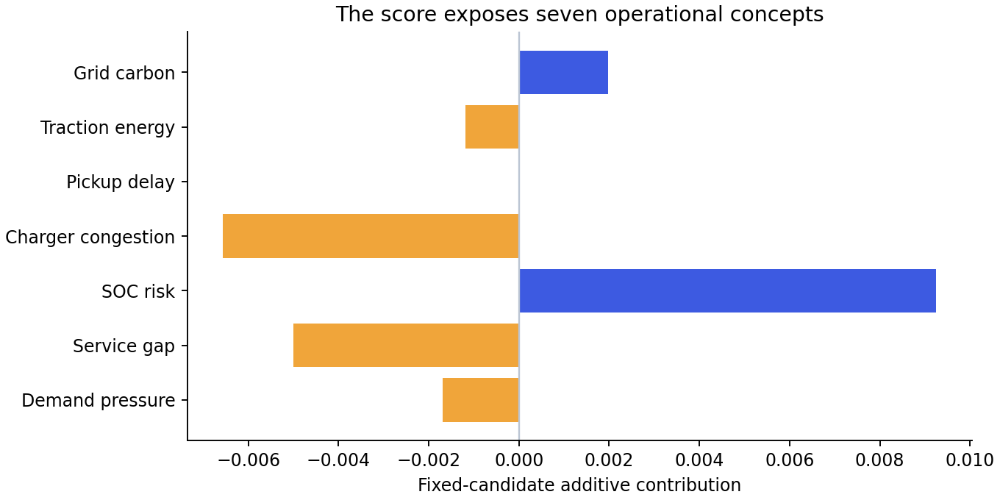

<p align="center"></p>

<p align="center">
  
  
  
  <a href="https://github.com/7WD1/TR-C-Papercode/actions/workflows/check.yml"></a>
</p>

<p align="center"><b>Seven operational concepts. Joint dispatch, rebalancing and charging. Audited feasible decisions.</b></p>

This repository reconstructs the **XG-DOP method** for *An Explainable Graph Decision and Optimization Framework with Feasibility Guarantees for Real-Time Electric Vehicle Fleet Scheduling*. It implements a heterogeneous temporal graph actor, a seven-concept bottleneck, a four-dimensional residual, prediction and imitation learning, differentiable decision-focused learning, hybrid-proposal PPO, and mixed binary/continuous feasibility projection.

The included CPU scenario is a small **synthetic method smoke test**. Its inputs and outputs are generated by the code. It does not reproduce the paper's city datasets, SUMO calibration, trained checkpoints, comparison algorithms, experimental tables or reported latency. No manuscript benchmark numbers are hard-coded into the program.

## Run in a minute

```bash
python -m venv .venv
# Windows PowerShell: .venv\Scripts\Activate.ps1
# Linux/macOS: source .venv/bin/activate
python -m pip install -r requirements.txt
python -m xgdop.demo
python -m pytest -q
```

The default command runs all four training stages, two PPO epochs, four deterministic closed-loop control steps, concept and graph audits, an alternative-action counterfactual grid, and a deliberately inconsistent net-rebalancing target to exercise the fallback. The default fixture has six vehicles, three zones and two stations.

| Command | Purpose |
|---|---|
| `python -m xgdop.demo` | Complete CPU method smoke run |
| `python -m xgdop.demo --no-train` | Inference, certificates and explanation paths |
| `python -m xgdop.demo --no-rl` | Auxiliary learning with PPO, GAE and critic updates disabled |
| `python -m xgdop.demo --hierarchical` | Nested geometry/score candidate selection and joint projection |
| `python -m xgdop.demo --config configs/paper_architecture.json` | Paper encoder width/head count on the same synthetic fixture |
| `python -m pytest -q` | Feasibility, gradient and PPO accounting checks |

Each run writes `outputs/smoke/report.json`, `training.csv`, `checkpoint.pt`, `fleet_snapshot.png` and `concept_contributions.png`. The output directory can be set with `--output`. For every executed control step, the report stores the complete decision vector and coordinate identities, selected assignments, idle vehicles, rejection bits, grid-side energy by charging arc, vehicle SOC before/predicted after/physically simulated after, and committed plus newly selected station usage. It also includes every affine constraint residual, solver status, optimality gap, fallback slacks, sampled-likelihood diagnostics, configuration and library versions. Outputs are excluded from Git; the two README previews below are copied from an actual smoke run.

<p align="center"></p>

## One decision path



The actor does not select independent final fleet actions. Its proposal can contain request conflicts and station overloads. The master projection resolves those interactions jointly. Idle probability is the unused mass in the vehicle-action inequality, and every request has an explicit rejection variable.

## What is implemented

| Module | Executable behavior |
|---|---|
| `environment.py` | Stochastic demand, EV SOC, trip occupancy, charging, prices/carbon and domain randomization; synthetic Euclidean coordinates |
| `model.py` | Four learned edge families, type-specific inputs, multi-head graph attention, GRU node memory and mean pooling |
| `model.py` | Demand/supply and travel/energy quantiles at 0.10, 0.25, 0.50, 0.75 and 0.90; cumulative softplus prevents crossings |
| `model.py` | Demand pressure, service gap, SOC risk, charger congestion, pickup delay, traction energy and grid carbon; additive action-conditioned weights and residual |
| `hierarchy.py` | Balanced spatial queries, growing per-type quotas, per-zone probability budgets, cumulative retention and complete final support |
| `projection.py` / `scip_worker.py` | Actual mixed binary/continuous quadratic projection, independent feasibility audit, and net-target-only slack fallback |
| `projection.py` | OSQP continuous relaxation and a local fixed-active-set KKT backward pass to the decoded proposal |
| `training.py` | Prediction pretraining, MIQP-teacher behavior cloning, one-step relaxed decision regret and explanation/feasibility losses |
| `training.py` | Terminal-aware GAE, clipped PPO surrogate, value loss and entropy; domain-randomized auxiliary and PPO cycles |
| `explanations.py` | Intrinsic contributions, exhaustive local score Shapley audit, optimized per-instance edge masks, learned parametric edge gates and finite-grid counterfactual search |

The optimized masks and parametric gates are GNNExplainer-style and PGExplainer-style reconstruction modules. They are not reproductions of the paper's comparative explanation benchmark. The exhaustive 128-coalition Shapley calculation audits a **fixed candidate score** while holding concept weights and residual fixed. It is not equated with projected-action attribution. The counterfactual searches a declared finite admissible grid and reports the minimum within that grid; it does not claim a global continuous optimum.

<p align="center"></p>

## Projection and training semantics

The deployment objective is

```text
minimize  sum_c W_c (a_c - proposal_c)^2 + beta * operating_cost(a)
subject to binary dispatch/rebalance/charge/rejection variables,
           continuous grid-side charging energy,
           request coverage, vehicle exclusivity, SOC bounds,
           range/pickup screening, charging links, residual ports/power,
           and prescribed inter-zone net rebalancing.
```

The seven-component objective includes waiting, rejection, empty travel, electricity, carbon, degradation and active-zone service disparity. Service disparity uses an exact affine epigraph. The projection weights normalize each charging-energy coordinate by its available energy range; binary-coordinate weights are one.

SCIP handles the quadratic objective through an equivalent convex epigraph, following its [official nonlinear-objective documentation](https://pyscipopt.readthedocs.io/en/stable/tutorials/expressions.html). Binary square terms use the exact identity `b² = b`; charging energy remains continuous and quadratic. There is no greedy replacement presented as MIQP. Primary-optimal solutions receive a lexicographic binary tie-break within solver tolerances when the reserved primary budget permits it. The certificate records whether this second stage completed; a time-limit incumbent still receives a feasibility audit.

If the standard problem returns no feasible incumbent, the fallback retains every safety, capacity, exclusivity and request-accounting constraint. Only the prescribed net-flow equalities receive nonnegative positive/negative slacks. A reject-and-idle incumbent makes the fallback feasible under safe initial SOC and valid committed-capacity inputs. Original flow residuals are reported separately. This small reconstruction solves the fallback with SCIP from that incumbent; it does not reproduce the paper's separate first-improvement fallback search.

During DFL, [OSQP](https://osqp.org/docs/interfaces/python.html) solves the same affine constraints after relaxing binary domains to `[0,1]`. A KKT derivative propagates gradients to the decoded proposal while the prediction coefficients, graph/discrete support and constraint data are locally fixed. It is tested by central finite differences on a stable active set. It does not differentiate the discrete MIQP, topology changes, arc screening or arbitrary active-set transitions. Forecast heads learn through quantile supervision; the shared encoder also receives actor/DFL gradients.

The SCIP process is isolated from PyTorch to avoid incompatible Windows Intel OpenMP runtimes. No `KMP_DUPLICATE_LIB_OK` override is used. Process startup time is part of this implementation's wall time and is not comparable to the paper's reported in-process solver latency.

### PPO uses the sampled proposal

For each stored state, the actor samples:

1. One categorical action per dispatchable vehicle, including idle.
2. An independent Bernoulli rejection bit for each request.
3. An independent Beta charging fraction for **every eligible charging arc**. Its mean is the existing sigmoid energy head clipped to `[0.01, 0.99]`; concentration is fixed at 2.

The proposal has `q = q_max * selected_charge * fraction`. The stored likelihood is the joint density of these latent categorical choices, rejection bits and Beta fractions, including fractions of inactive arcs. Its density is never assigned to the many-to-one projected action. The reward is the negative normalized cost of the action actually executed after projection.

Old log probabilities, full action support, action identities and all projection matrices/coefficients are cached at collection. Auxiliary prediction/IL/DFL updates occur **between** PPO cycles. Within a PPO cycle, reevaluation uses the stored support and sampled latent variables; no projection is recomputed. Shared actor/critic encoder parameters may update, while the environmental projection snapshot stays fixed. Each new auxiliary update is followed by a fresh rollout.

The minimization loss is the negative clipped policy surrogate plus `0.5 * value MSE - 0.01 * entropy`. Defaults are discount `0.99`, GAE `0.95`, clip `0.2` and RL weight `1`. Terminal flags zero both the bootstrap and the carried GAE. Setting the RL weight to zero skips collection, GAE, PPO and critic updates.

## Configuration and synthetic assumptions

All executable settings live in [configs/demo.json](configs/demo.json). The default encoder width is 32 with two heads for a fast CPU smoke test. [configs/paper_architecture.json](configs/paper_architecture.json) sets the manuscript width to 128 and uses four heads. Both use two graph layers, a one-layer GRU, 12 historical intervals, a three-interval prediction horizon, seven concepts and residual dimension four.

| Input | Synthetic default / unit |
|---|---|
| Control interval | 5 minutes |
| Fleet / zones / stations | 6 / 3 / 2 |
| Request generator | Five new requests per interval; uniformly sampled origin/destination zones with coordinate noise |
| Spatial/travel model | Euclidean coordinates in km; 0.5 km/min, no traffic microsimulation |
| Traction energy | 0.20 kWh/km times an optional domain multiplier; includes passenger-trip distance for service |
| Battery / initial SOC / safe SOC | 60, 80 or 100 kWh / uniform 0.25–0.80 / 0.15 |
| Charger ports / station power / pair power | 2 / 100 kW / 50 kW |
| Charging efficiency / maximum wait | 0.90 / 10 minutes |
| Price / carbon | Station values 0.20–0.40 currency/kWh / 250–600 gCO₂/kWh |
| Already committed charging | Explicit residual-capacity fields, zero in default fixture |
| Trips already in progress | Excluded from dispatchable vehicle nodes; counted in zonal committed supply |
| Unserved requests | Rejected and leave this one-step fixture; no inter-interval waiting queue |
| Future prediction labels | Known synthetic generator expectations; current counts and physical action targets |
| Normalization | Fixed exposed synthetic scales with zero minima; not empirical city-training bounds |
| Domain randomization | Demand 0.7–1.3, travel 0.8–1.2, energy 0.85–1.15, station-failure probability 0–0.2 |

These assumptions replace unavailable city instances, calibration inputs and original training artifacts. The simulator checks prediction-based modeled constraints separately from physical evolution. A zero modeled certificate is not a claim about unmodeled real-world energy or latency. The six-update smoke history checks execution and finite gradients; it is not a convergence experiment or a 200-epoch training run.

## Validation

The focused suite checks mixed-integer feasibility against an independently evaluated constraint certificate, explicit request coverage and exclusivity, reported fallback slacks, a finite-difference QP gradient, noncrossing quantiles and relation-specific graph gradients, terminal GAE, PPO likelihood ratios and minimization sign, full RL disablement, exhaustive local score Shapley values, and nested candidate feasibility.

The local Windows CPU run passed **11 tests**. The full smoke and no-RL smoke each executed four decisions with maximum modeled constraint violation `0.0`; the deliberately impossible net target activated the reported fallback. These are software checks on the small synthetic fixture. GitHub Actions repeats tests and smoke execution on Linux and uploads the generated artifacts.

## Repository map

```text
configs/       explicit synthetic settings and paper encoder architecture
xgdop/         environment, actor–critic, projection, training and explanations
tests/         focused feasibility/gradient/PPO checks
assets/        vector banner and actual smoke-run plots
outputs/       local JSON reports, checkpoint and plots (ignored by Git)
```

The code release covers executable method reconstruction. Public-data ingestion, full calibrated SUMO city environments, original model weights, original logs and manuscript-result regeneration require the corresponding research artifacts.
